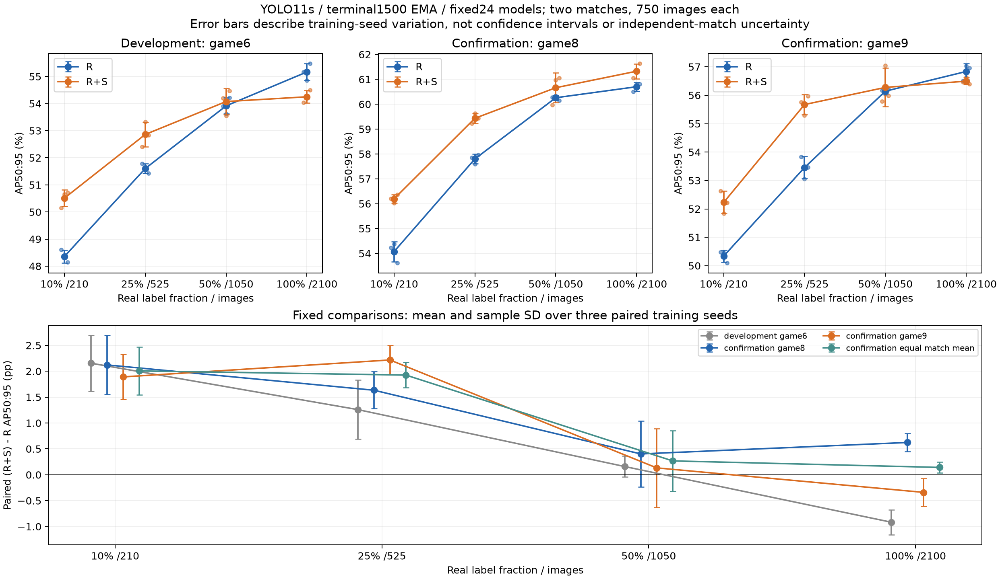

# BBox 正式实验与结果清单

状态：2026-11-05阶段结束；无训练、推理或自动追加实验。

## 纳入范围

| 分类 | 数量 | 纳入理由 |
| --- | ---: | --- |
| 主表训练 | 24 | seed17/29/43 × 100/50/25/10%真实标注 × R/R+S，均1500更新 |
| 比赛外确认 | 48 | 上述24末步EMA各在game8/game9评价750图 |
| 正式策略/预算对照 | 4 | 单阶段真实、同总量混合及短两阶段配对 |
| 数据域差分析 | 1 | 现有训练/开发集的人数、统一尺度尺寸与框重叠代理统计 |

不将各组混为同一个训练预算。28项保留的训练记录是24主表＋4对照；主结论只采用预定主表及固定确认范围。正式失败、人工中断、准入与源码血缘是证据链的一部分，不按成绩高低或状态名称删除。

## 主表固定协议

公开YOLO11s独立起点；960 FP32；microbatch8、累积2、有效batch16；workers2；1500更新；R累计24000R，R+S累计12000R/12000S。SGD Nesterov，warmup100，峰值LR0.001完整cosine至0.00001，momentum0.8→0.937，WD0.0005，clip10。末1500 EMA，不选best。数据选择seed17固定，训练seed17/29/43不重选子集。

检查点0/1000/1500及合法额外边界；阶段0和末步真实开发评价；逐步记录、完整raw/EMA/SGD/RNG/采样器状态、native预测/JSON和失败证据保留。原冻结协议与数据/源码绑定见机器清单，不从本摘要重新构造原始收据。

## 主表24项：game6开发集末步结果

以下AP均为百分值，三指标按AP50:95 / AP50 / AP75排列。

| seed | 真实图数 | 策略 | AP50:95 | AP50 | AP75 |
| ---: | ---: | --- | ---: | ---: | ---: |
| 17 | 2100 | R | 55.1634 | 95.8765 | 56.8724 |
| 17 | 2100 | R+S | 54.0447 | 95.8582 | 54.1364 |
| 17 | 1050 | R | 53.9112 | 95.2937 | 54.3727 |
| 17 | 1050 | R+S | 54.2074 | 95.5453 | 54.3608 |
| 17 | 525 | R | 51.7867 | 94.8368 | 49.8595 |
| 17 | 525 | R+S | 52.4119 | 95.0186 | 50.4439 |
| 17 | 210 | R | 48.6130 | 91.9439 | 44.7276 |
| 17 | 210 | R+S | 50.1585 | 94.0654 | 46.3719 |
| 29 | 2100 | R | 54.8592 | 95.6748 | 55.8286 |
| 29 | 2100 | R+S | 54.2122 | 96.0281 | 54.4384 |
| 29 | 1050 | R | 53.6215 | 95.1746 | 53.0580 |
| 29 | 1050 | R+S | 53.5468 | 95.8996 | 52.8040 |
| 29 | 525 | R | 51.5909 | 93.6870 | 50.0534 |
| 29 | 525 | R+S | 53.3280 | 95.2616 | 53.0151 |
| 29 | 210 | R | 48.3138 | 91.8988 | 44.7961 |
| 29 | 210 | R+S | 50.6600 | 93.6258 | 48.5961 |
| 43 | 2100 | R | 55.4830 | 95.4244 | 57.7311 |
| 43 | 2100 | R+S | 54.4972 | 96.1166 | 54.7277 |
| 43 | 1050 | R | 54.2182 | 95.2366 | 54.5437 |
| 43 | 1050 | R+S | 54.4733 | 96.1588 | 55.0642 |
| 43 | 525 | R | 51.4324 | 94.0356 | 49.4890 |
| 43 | 525 | R+S | 52.8439 | 95.8857 | 51.3813 |
| 43 | 210 | R | 48.1442 | 91.9927 | 44.5769 |
| 43 | 210 | R+S | 50.7137 | 94.1679 | 48.2175 |

## 固定两场确认

[48项逐模型绝对AP表](bbox_confirmation.csv)、[各场与开发集均值/样本SD](bbox_summary.csv)、[逐seed配对差](bbox_paired_differences.csv)、[同模型两场等权均值](bbox_equal_match_per_seed.csv)。CSV原样复制自已终验封存结果，不重新计算推理。

25%和10%在两场各三seed均正；50%含负seed，100%在game8/game9方向相反。两场等权平均先按同模型计算，再按三seed统计，既不是合并COCO AP，也不是六个独立比赛。SD是训练随机性样本SD，不是CI。game9已观察、game8曾下载和访问GT结构，不称首次盲测；未用test选择方法。

R与R+S总曝光相同而真实曝光不同，结论属于整体配方效用，不能拆出合成数据的单一机制因果。未预定等效/非劣效界限，不能据此宣布节省75%或90%标注。

## 正式辅助对照

| 分类 | 实验 | 更新 | game6 AP50:95 | AP50 | AP75 |
| --- | --- | ---: | ---: | ---: | ---: |
| formal_secondary | R_seed17 | 6563 | 51.6512 | 94.1100 | 50.5687 |
| formal_secondary | R_plus_S_fixed_budget_seed17 | 6563 | 53.9318 | 95.7025 | 54.6063 |
| formal_secondary | short2_S_to_R_seed17 | 6563 | 51.9372 | 94.9189 | 50.9338 |
| formal_secondary | short2_R_to_R_seed17 | 6563 | 52.3931 | 94.3188 | 52.2550 |

辅助对照只有seed17、已观察的game6开发评价，不纳入三seed主表或两场确认；不同阶段和预算的结果分别解释。2026-11-07按用户选择删除校准R50/R100和36750步R→R、S→R的运行产物，保留单阶段R所引用的两份准入与预算收据。

## 原始证据、清理与复现边界

[正式机器清单](bbox_formal_registry.json)绑定原job table、终点状态、checkpoint receipt、控制清单、数据与三份冻结方案SHA；大文件仍在D/G实际执行组，未复制入Git。48确认的29项执行于11月4日旧组、19项执行于11月5日新组；继承收据保留旧路径/时间，不能当作48项都在新组重新推理。

[清理清单摘要](bbox_cleanup_20261105.json)：用户明确允许清理后，删除方案已弃用的S3000截断前缀诊断、无引用临时预检日志、旧观察台日志与纯CPU筛选微基准；未删除正式负结果、GT、公开基座、输入缓存或Seg/Pose资料。旧前缀D组只留正式代码依赖的不可变40模块及绑定，不留启动器/训练结果，不提供可恢复旧诊断入口。

保留原始GT与模型/预测/逐步日志/完整状态是保留28项正式训练和48确认的条件。仓库只提交代码、测试、固定子集manifest和小结果；环境、模型、缓存、raw预测及本机服务登记不提交。此文是已完成结果索引，不是新实验授权。
